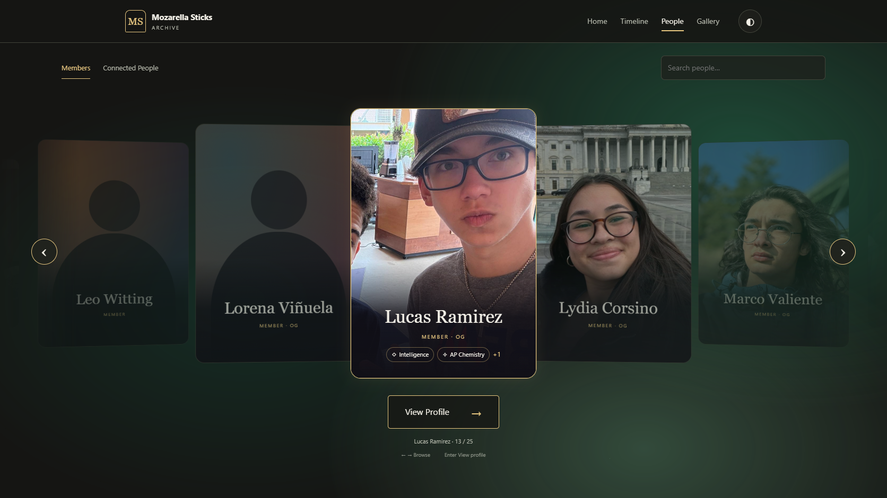
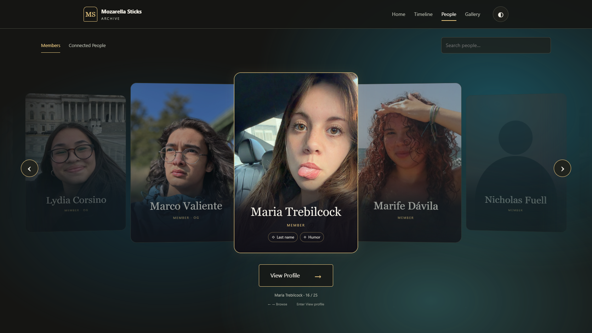
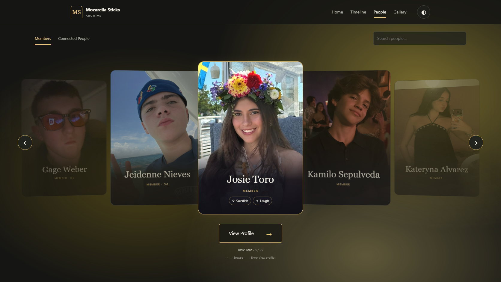
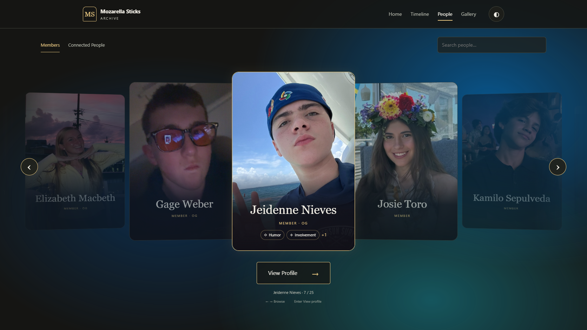
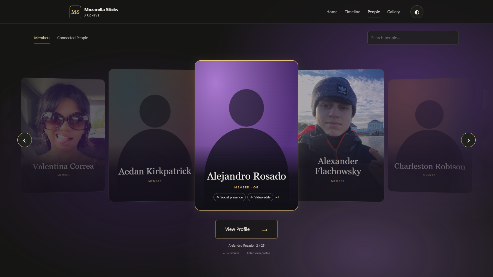
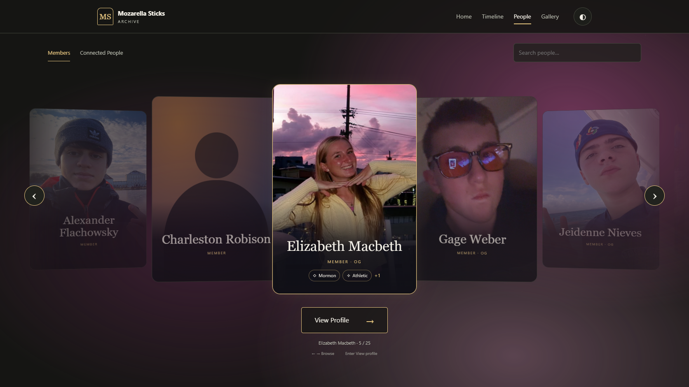

# Personalized palette review — October 29, 2026

Targeted update to existing draft PR #13 / `feat/revision-3-people`, based on portrait-upload commit `ba32431`. No merge or publication.

The six approved palettes are optional `palette` arrays in `data/people.json`: three `#RRGGBB` values in dark, middle, light order. The resolver prioritizes a valid explicit palette and otherwise retains the exact prior deterministic default. Future changes require only editing this JSON array; see [format and example](../README.md#personal-background-palettes).

No CSS, layout, navigation, portrait loader, historical events/media, biographies, or membership classifications changed. The only changes to people records are these six arrays. Ambient fields still drift on 23–31 second cycles and blend colors over 0.9 seconds. Existing masks/opacity restrain bright colors; the gold outline and text/control styling are unchanged. All existing editorial accents and portrait/silhouette backgrounds share the same resolver.

## Screenshots of all six backgrounds

Each link shows the real current website, including the uploaded originals where available. Alejandro currently has no JPG, so his purple silhouette is intentional. Desktop: 1672 × 941; mobile: 390 × 844.

| Person | Theme | Desktop dark | Desktop light | Mobile dark | Mobile light |
|---|---|---|---|---|---|
| Lucas | Forest Green | [View](palettes/lucas-desktop-dark.png) | [View](palettes/lucas-desktop-light.png) | [View](palettes/lucas-mobile-dark.png) | [View](palettes/lucas-mobile-light.png) |
| Maria | Ocean Teal | [View](palettes/maria-desktop-dark.png) | [View](palettes/maria-desktop-light.png) | [View](palettes/maria-mobile-dark.png) | [View](palettes/maria-mobile-light.png) |
| Josie | Soft Sunshine Yellow | [View](palettes/josie-desktop-dark.png) | [View](palettes/josie-desktop-light.png) | [View](palettes/josie-mobile-dark.png) | [View](palettes/josie-mobile-light.png) |
| Jeidenne | Electric Cyan | [View](palettes/jeidenne-desktop-dark.png) | [View](palettes/jeidenne-desktop-light.png) | [View](palettes/jeidenne-mobile-dark.png) | [View](palettes/jeidenne-mobile-light.png) |
| Alejandro | Royal Purple | [View](palettes/alejandro-desktop-dark.png) | [View](palettes/alejandro-desktop-light.png) | [View](palettes/alejandro-mobile-dark.png) | [View](palettes/alejandro-mobile-light.png) |
| Elizabeth / Libby | Rose Pink | [View](palettes/libby-desktop-dark.png) | [View](palettes/libby-desktop-light.png) | [View](palettes/libby-mobile-dark.png) | [View](palettes/libby-mobile-light.png) |

## Verification

- The six approved arrays match exactly. Every other person resolves to their unchanged preset. Invalid arrays fall back safely.
- All six were selected through carousel search, in dark/light themes on desktop/mobile. Each field was sampled before, during, and after transition to confirm actual interpolation, not an instantaneous replacement. Ambient animation and gold outline were checked. All six editorial profiles use the matching palette. No horizontal overflow.
- All **16 uploaded original JPGs** load successfully in both directory and profile; their file contents are unchanged. The original People suite now recognizes existing portraits and never overwrites/removes them while testing fixture uploads for missing portraits.
- Reduced motion remains functional for all six; ambient animation and transitions stop as intended.
- Archive validator: **0 errors, 0 warnings**. All **13 Python tests** pass; shared script syntax and whitespace checks pass.
- Existing People browser regression passes: all 37 profiles, navigation/search/selection memory, motion, media viewer, upload fallback, 24 responsive page/theme cases.
- Full archive regression passes: 112 full-event pages, 122 Gallery items, all filters, 20 video playback checks, Media Manager safeguards and diagnostics, 60 existing-page/theme cases. Its empty-state assertion now awaits the existing scheduled render to avoid a timing race; no Media Manager production code changed.

[Palette results](palettes/results.json) · [People regression](palettes/people-regression-results.json) · [Full archive regression](palettes/archive-regression-results.json)

Reproduce with `node tests/people-palettes.cjs` against a local preview server. It uses the same optional `PLAYWRIGHT_MODULE`, `CHROME_BIN`, `BASE_URL`, and `REVIEW_OUTPUT` environment variables as the other browser suites.

Visual inspection included all six requested backgrounds, with attention to the pale yellow and bright cyan in both site themes. Browser tests use desktop Chrome and emulated mobile sizes; physical devices, Safari/Firefox, and screen-reader sessions were not re-tested. The portrait upload changes are preserved; this update does not publish them to main.

## Desktop dark previews

### Lucas

### Maria

### Josie

### Jeidenne

### Alejandro

### Elizabeth / Libby

